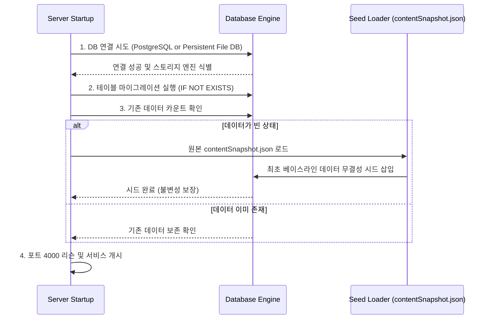

# 백엔드 아키텍처 명세서 (BACKEND_ARCHITECTURE.md)

프로젝트: `company` (PRISM)  
런타임: **Node.js v24.16.0 LTS**  
프레임워크: **Express 4.x / 5.x**  
데이터베이스: **PostgreSQL** (투명한 복원력 및 파일 영속 스토리지 지원)

---

## 1. 아키텍처 개요 및 원칙

1. **계층형 아키텍처 (Layered Architecture)**:
   - **Router**: URL 라우팅 및 HTTP 메서드 매핑
   - **Middleware**: 인증, 보안 헤더, 요청 로깅, 속도 제한, 에러 필터링
   - **Controller**: HTTP 요청/응답 처리, 상태 코드 제어, 입력값 유효성 검증
   - **Service**: 비즈니스 로직, 데이터 무결성 규칙, 감사 로그 기록
   - **Repository / Data Access**: 데이터베이스 쿼리 추상화
2. **이중 스토리지 지원 (Dual Storage Engine with Transparent Failover)**:
   - `DATABASE_URL` 또는 PostgreSQL 연결 정보가 유효하면 PostgreSQL 풀(`pg.Pool`)을 통해 운영.
   - 개발 환경에서 로컬 PostgreSQL 서비스가 구동되지 않는 경우, 파일 기반 영속 스토리지(JSON/SQLite DB)로 투명하게 전환하되 콘솔 및 헬스체크 API에 정확한 스토리지 상태(`engine: 'sqlite' | 'json' | 'postgres'`)를 기록하여 개발자가 즉시 인지하도록 설계.
3. **무상태성 및 보안**:
   - 비밀키 및 토큰은 오직 서버 환경 변수(`.env`)로만 관리하며 클라이언트로 절대 노출하지 않음.
   - 인증 쿠키는 `HttpOnly; SameSite=Strict; Secure(운영환경)` 설정.

---

## 2. 서버 디렉터리 구조

```text
server/
├── src/
│   ├── app.js                  # Express 앱 설정 및 미들웨어 바인딩
│   ├── server.js               # 서버 포트 리슨 (기본 4000)
│   ├── config/
│   │   ├── env.js              # 환경 변수 유효성 검사 및 설정
│   │   └── database.js         # PostgreSQL 풀 및 스토리지 엔진 초기화
│   ├── routes/
│   │   ├── index.js            # 메인 라우터 애그리게이터
│   │   ├── public.routes.js    # 공개 API (health, site, home, gallery 등)
│   │   └── admin.routes.js     # 관리자 API (인증, 편집, 미디어)
│   ├── controllers/
│   │   ├── public.controller.js
│   │   └── admin.controller.js
│   ├── services/
│   │   ├── content.service.js  # 콘텐츠 조회 및 비즈니스 로직
│   │   └── auth.service.js     # 관리자 로그인/토큰 관리
│   ├── repositories/
│   │   ├── content.repository.js # DB 추상화 레포지토리
│   │   └── postgres.repository.js# PostgreSQL 전용 쿼리 구현체
│   └── middleware/
│       ├── auth.middleware.js   # JWT / 세션 검증
│       ├── security.middleware.js # Helmet, CORS, Rate Limit
│       ├── logger.middleware.js # 구조화된 요청 로거
│       └── error.middleware.js  # 중앙 집중형 에러 핸들러
├── db/
│   ├── migrations/
│   │   └── 001_create_tables.sql
│   └── seeds/
│       └── 001_initial_content.json / .sql
├── package.json                # 백엔드 전용 패키지 정의
└── .env.example                # 환경 변수 템플릿
```

---

## 3. 핵심 모듈 및 책임

### 3.1 보안 계층 (Security Layer)
- **Helmet**: `Content-Security-Policy`, `X-Frame-Options`, `X-Content-Type-Options` 등 헤더 자동 설정.
- **CORS**: 허용된 오리진(`http://localhost:5173`, `http://localhost:4000`)에만 리소스 접근 허용.
- **Rate Limiting**: IP당 15분당 500회 제한 (로그인은 분당 10회 제한으로 Brute Force 방어).
- **입력 유효성 검사**: Express-validator 기반 스키마 검증으로 SQL Injection 및 XSS 공격 방어.

### 3.2 로깅 및 모니터링
- 모든 HTTP 요청에 대해 `method`, `url`, `status`, `durationMs`, `clientIp`를 JSON 형태의 구조화된 로그로 출력.
- 비정상 오류 발생 시 스택 트레이스는 서버 콘솔에만 기록하고 클라이언트에는 표준화된 안전한 에러 응답(`{ error: { code: 'INTERNAL_ERROR', message: '...' } }`)만 전달.

---

## 4. 데이터베이스 및 시드 흐름


