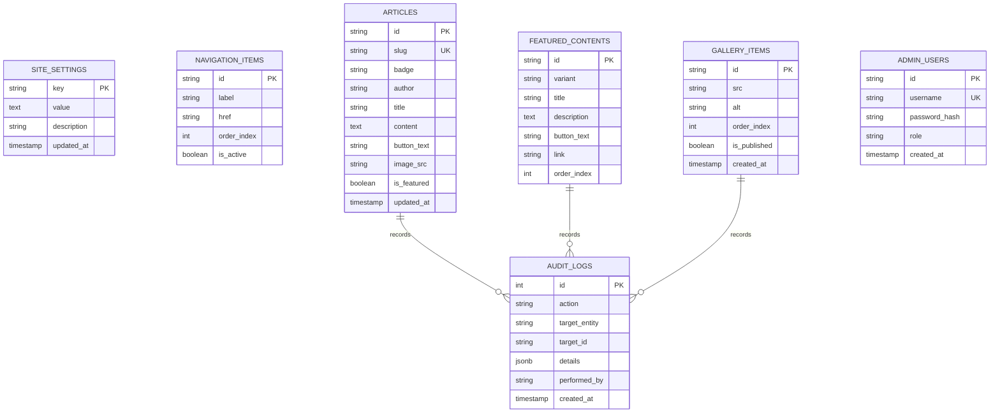

# 데이터베이스 설계 및 스키마 명세서 (DATABASE_DESIGN.md)

프로젝트: `company` (PRISM)  
데이터베이스: **PostgreSQL 14+ 호환 관계형 스키마**

---

## 1. 개체 관계 모델 (ERD)



---

## 2. 테이블 상세 정의

### 2.1 `site_settings`
- 사이트 메타데이터, 브랜드명, 저작권, 기본 설명 저장.
- **초기 시드**:
  - `site_name`: `'company'`
  - `brand_logo_src`: `'/images/logo.png'`
  - `brand_logo_alt`: `'PRISM'`
  - `copyright`: `'2026 Green Systems Incorporated. All rights reserved.'`
  - `footer_description`: `'Lorem ipsum dolor sit amet consectetur adipisicing elit. Facere, necessitatibus!'`

### 2.2 `navigation_items`
- 상단 헤더 메뉴 항목 정의.
- **컬럼**:
  - `id` VARCHAR(50) PRIMARY KEY
  - `label` VARCHAR(100) NOT NULL
  - `href` VARCHAR(255) NOT NULL
  - `order_index` INT NOT NULL
  - `is_active` BOOLEAN DEFAULT TRUE
- **초기 시드**:
  - `1`: `Architecture`, `#`, order 1
  - `2`: `Travel`, `#`, order 2
  - `3`: `Art`, `#`, order 3
  - `4`: `Food`, `#`, order 4

### 2.3 `articles` (Hero 및 개별 아티클)
- 히어로 메인 기사 및 에디토리얼 아티클 데이터.
- **초기 시드 (Hero 기사)**:
  - `id`: `'hero-urban-strorkes'`
  - `slug`: `'urban-strorkes'`
  - `badge`: `'Editor\'s Choice'`
  - `author`: `'Sebastian Weiss'`
  - `title`: `'Urban Strorkes'` (원본 철자 보존)
  - `button_text`: `'Read More'`
  - `image_src`: `'/images/hero.jpg'`
  - `is_featured`: `true`

### 2.4 `featured_contents` (Content Cards)
- 본문 2대 카드(`Inspring Reads`, `Reflections`) 관리.
- **초기 시드**:
  - 카드 1: `id: 'card-1'`, `variant: 'tan'`, `title: 'Inspring Reads'`, `description: 'Lorem ipsum dolor sit, amet consectetur adipisicing elit. Eum, est doloribus'`, `button_text: 'Read More'`, `link: ''`, `order: 1`
  - 카드 2: `id: 'card-2'`, `variant: 'dark'`, `title: 'Reflections'`, `description: 'Lorem ipsum dolor sit, amet consectetur adipisicing elit. Eum, est doloribus'`, `button_text: 'Read More'`, `link: ''`, `order: 2`

### 2.5 `gallery_items` (Gallery)
- 갤러리 이미지 4점 관리.
- **초기 시드**:
  - `gal-1`: `src: '/images/gallery-1.jpg'`, `alt: 'Spiral architectural staircase'`, `order: 1`
  - `gal-2`: `src: '/images/gallery-2.jpg'`, `alt: 'Suspension bridge perspective'`, `order: 2`
  - `gal-3`: `src: '/images/gallery-3.jpg'`, `alt: 'Angular modern architecture facade'`, `order: 3`
  - `gal-4`: `src: '/images/gallery-4.jpg'`, `alt: 'Curved skyscraper glass grid'`, `order: 4`

### 2.6 `admin_users` & `audit_logs`
- 관리자 로그인 정보 및 모든 데이터 변경(생성, 수정, 삭제) 이력을 JSON 형식으로 기록.

---

## 3. SQL 마이그레이션 스크립트 (`db/migrations/001_create_tables.sql`)

```sql
-- Site Settings Table
CREATE TABLE IF NOT EXISTS site_settings (
    key VARCHAR(64) PRIMARY KEY,
    value TEXT NOT NULL,
    description VARCHAR(255),
    updated_at TIMESTAMP WITH TIME ZONE DEFAULT CURRENT_TIMESTAMP
);

-- Navigation Items Table
CREATE TABLE IF NOT EXISTS navigation_items (
    id VARCHAR(64) PRIMARY KEY,
    label VARCHAR(100) NOT NULL,
    href VARCHAR(255) NOT NULL,
    order_index INT NOT NULL DEFAULT 0,
    is_active BOOLEAN NOT NULL DEFAULT TRUE,
    created_at TIMESTAMP WITH TIME ZONE DEFAULT CURRENT_TIMESTAMP
);

-- Articles / Hero Table
CREATE TABLE IF NOT EXISTS articles (
    id VARCHAR(64) PRIMARY KEY,
    slug VARCHAR(128) UNIQUE NOT NULL,
    badge VARCHAR(100),
    author VARCHAR(100),
    title VARCHAR(255) NOT NULL,
    content TEXT,
    button_text VARCHAR(64) DEFAULT 'Read More',
    image_src VARCHAR(255) NOT NULL,
    is_featured BOOLEAN DEFAULT FALSE,
    is_published BOOLEAN DEFAULT TRUE,
    created_at TIMESTAMP WITH TIME ZONE DEFAULT CURRENT_TIMESTAMP,
    updated_at TIMESTAMP WITH TIME ZONE DEFAULT CURRENT_TIMESTAMP
);

-- Featured Cards Table
CREATE TABLE IF NOT EXISTS featured_contents (
    id VARCHAR(64) PRIMARY KEY,
    variant VARCHAR(32) NOT NULL,
    title VARCHAR(255) NOT NULL,
    description TEXT NOT NULL,
    button_text VARCHAR(64) DEFAULT 'Read More',
    link VARCHAR(255) DEFAULT '',
    order_index INT NOT NULL DEFAULT 0,
    created_at TIMESTAMP WITH TIME ZONE DEFAULT CURRENT_TIMESTAMP,
    updated_at TIMESTAMP WITH TIME ZONE DEFAULT CURRENT_TIMESTAMP
);

-- Gallery Items Table
CREATE TABLE IF NOT EXISTS gallery_items (
    id VARCHAR(64) PRIMARY KEY,
    src VARCHAR(255) NOT NULL,
    alt VARCHAR(255) NOT NULL,
    caption TEXT,
    order_index INT NOT NULL DEFAULT 0,
    is_published BOOLEAN DEFAULT TRUE,
    created_at TIMESTAMP WITH TIME ZONE DEFAULT CURRENT_TIMESTAMP
);

-- Admin Users Table
CREATE TABLE IF NOT EXISTS admin_users (
    id VARCHAR(64) PRIMARY KEY,
    username VARCHAR(64) UNIQUE NOT NULL,
    password_hash VARCHAR(255) NOT NULL,
    role VARCHAR(32) DEFAULT 'admin',
    created_at TIMESTAMP WITH TIME ZONE DEFAULT CURRENT_TIMESTAMP
);

-- Audit Logs Table
CREATE TABLE IF NOT EXISTS audit_logs (
    id SERIAL PRIMARY KEY,
    action VARCHAR(64) NOT NULL,
    target_entity VARCHAR(64) NOT NULL,
    target_id VARCHAR(64) NOT NULL,
    details JSONB,
    performed_by VARCHAR(64) NOT NULL,
    created_at TIMESTAMP WITH TIME ZONE DEFAULT CURRENT_TIMESTAMP
);
```
