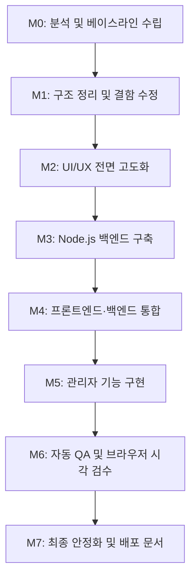

# 개발 단계 및 마일스톤 계획서 (DEVELOPMENT_PHASES.md)

프로젝트: `company` (PRISM)
목표: 기존 콘텐츠의 100% 보존 + 프리미엄 에디토리얼 UI/UX 고도화 + Node.js 24 + Express + DB 백엔드 구축 + 관리자 기능 + 전체 테스트 및 시각 검수 자동화

---

## 마일스톤 로드맵

---

### M0 — 프로젝트 분석 및 기준선 (현재 단계)
- [x] 전체 코드베이스 및 디렉터리 정밀 조사
- [x] Node.js 24 / npm / vite / git 환경 점검
- [x] 초기 브라우저 화면 검수 및 기준 스냅샷 캡처
- [x] `PROJECT_AUDIT.md` 작성
- [x] `CONTENT_INVENTORY.md` 작성
- [x] `CONTENT_PRESERVATION_REPORT.md` 작성
- [x] 기준 콘텐츠 JSON 스냅샷(`tests/snapshots/contentSnapshot.json`) 작성
- [x] 초기 git 커밋 및 베이스라인 브랜치 확보

### M1 — 구조 정리 및 오류 수정
- [ ] 이미지 경로 상대 경로(`images/`)에서 절대 경로(`/images/`)로 수정
- [ ] Sass 빌드 `@import` 폐지 경고 해결 및 모던 모듈 분리
- [ ] 디자인 토큰 정의 (CSS Custom Properties & SCSS 변수)
- [ ] Float 레이아웃을 모던 Flexbox/Grid 레이아웃으로 대체하기 위한 기본 구조 마련
- [ ] 시맨틱 마크업 및 접근성(Heading 계층, alt 텍스트, 키보드 포커스) 기본 보완
- [ ] 컴포넌트 분리 (`Header`, `Hero`, `FeaturedContent`, `Gallery`, `Footer`)
- [ ] ESLint 및 빌드 통과 검증

### M2 — UI/UX 전면 고도화 (프리미엄 에디토리얼)
- [ ] 타이포그래피 고도화: Google Fonts (`Plus Jakarta Sans` / `Cinzel` / `Playfair Display` 또는 고품격 Sans-Serif)
- [ ] 컬러 팔레트 조율: Ivory (#F7F5F0), Charcoal (#25262B), Champagne Gold (#B49A70) 적용
- [ ] Header 고도화: Sticky Header, 블러 효과(Backdrop filter), 모바일 햄버거 드로어 메뉴, 키보드 ESC 닫기
- [ ] Hero Section 고도화: 세련된 건축 잡지 스타일 오버레이, 텍스트 계층, 유려한 로딩/등장 애니메이션, Read More 모달/시각 피드백
- [ ] Content Cards 고도화: 미세 음영, 샴페인/다크 카드 표면 질감, 호버 마이크로 인터랙션, 완벽한 반응형 2열/1열 그리드
- [ ] Gallery Section 고도화: 균일한 종횡비(Aspect Ratio), 줌 호버 효과, 키보드/터치 지원 Lightbox 모달, 탭 포커스 트랩
- [ ] Footer 고도화: 정갈한 구분선, 여백 및 타이포그래피 정돈
- [ ] 반응형 뷰포트 지원: 375px 모바일, 768px 태블릿, 1280px 노트북, 1440px+ 대형 데스크톱
- [ ] 모션 접근성: `prefers-reduced-motion` 미디어 쿼리 준수

### M3 — Node.js 백엔드 개발 (Express REST API + PostgreSQL / Robust Persistence)
- [ ] `server/` 디렉터리 구축 (Node.js 24 ESM)
- [ ] Express REST API 서버 아키텍처 (Controller-Service-Repository 계층화)
- [ ] 데이터베이스 스키마 및 마이그레이션 (`SiteSettings`, `NavigationItem`, `FeaturedContent`, `Articles`, `GalleryItem`, `AdminUser`, `AuditLog`)
- [ ] 초기 원본 콘텐츠 기반 데이터베이스 시드(Seed) 작성
- [ ] 공개 API 엔드포인트 구현:
  - `GET /api/health`
  - `GET /api/site`
  - `GET /api/home`
  - `GET /api/categories`
  - `GET /api/articles`
  - `GET /api/articles/:slug`
  - `GET /api/gallery`
- [ ] 보안 미들웨어 구축: Helmet, CORS, Rate-Limiting, 요청 로깅, 에러 핸들러
- [ ] API 단위/통합 테스트 (Supertest)

### M4 — 프론트엔드·백엔드 통합
- [ ] 프론트엔드 API 클라이언트 서비스 (`src/services/api.js`)
- [ ] 데이터 로딩 상태(Skeleton/Spinner) 및 에러 처리(Fallback UI) 구현
- [ ] 환경 변수 분리 (`.env`, `VITE_API_BASE_URL`)
- [ ] API 데이터로 렌더링 시 기존 콘텐츠 100% 동일성 검증

### M5 — 관리자(Admin) 기능 구축
- [ ] 관리자 인증 시스템 (JWT / 세션, HttpOnly 쿠키)
- [ ] 관리자 대시보드 및 콘텐츠 편집 인터페이스
- [ ] 기존 콘텐츠 수정 및 발행 상태 관리
- [ ] 갤러리 순서 및 미디어 관리
- [ ] 감사 로그(Audit Log) 기록
- [ ] 공개 페이지와 명확한 분리 및 보안 통제

### M6 — 자동 QA 및 브라우저 시각 검수
- [ ] 단위 테스트 (Vitest + React Testing Library)
- [ ] 콘텐츠 무결성 자동 비교 테스트
- [ ] Playwright E2E 테스트 구축
- [ ] 반응형 4대 뷰포트 (375x812, 768x1024, 1280x800, 1440x900) 시각 검수
- [ ] axe-core 기반 WCAG 2.2 AA 접근성 검사
- [ ] 성능 최적화 검증 (LCP, CLS, FID/INP)
- [ ] 브라우저 서브에이전트 실제 시각 검수 보고서 작성

### M7 — 최종 안정화 및 문서화
- [ ] 발견된 버그 및 레이아웃 디테일 수정
- [ ] 최종 빌드 및 프로덕션 검증
- [ ] 전체 문서 완비 (`docs/*.md`, `README.md`)
- [ ] 최종 QA 및 배포 가이드라인 작성
