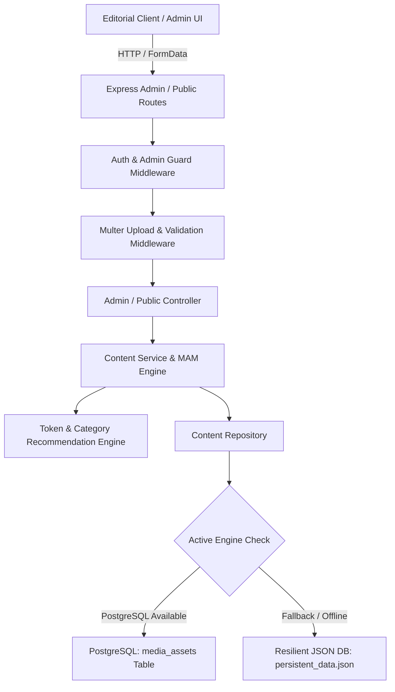

# PRISM Media Library Architecture & Ingestion Pipeline

## 1. Executive Architecture Overview

The PRISM Media Library is a full-stack digital asset management (DAM) system engineered specifically for high-end editorial and architectural publishing. It provides structured media ingestion, metadata governance, license verification, duplicate detection, and intelligent editorial media recommendation while strictly safeguarding baseline brand assets.



---

## 2. Dual-Engine Persistence Model

### 2.1 PostgreSQL Relational Model
The relational layer uses the `media_assets` table defined in migration `003_media_system_enhancement.sql`:

```sql
CREATE TABLE IF NOT EXISTS media_assets (
    id VARCHAR(64) PRIMARY KEY,
    src VARCHAR(512) NOT NULL,
    filename VARCHAR(255) NOT NULL,
    category_slug VARCHAR(64) NOT NULL DEFAULT 'architecture',
    title VARCHAR(255) NOT NULL,
    alt TEXT DEFAULT '',
    photographer VARCHAR(255) NOT NULL DEFAULT 'PRISM Contributor',
    source_name VARCHAR(255) NOT NULL DEFAULT 'Internal Library',
    source_url VARCHAR(1024) DEFAULT '',
    license_type VARCHAR(128) NOT NULL DEFAULT 'Editorial Rights',
    license_url VARCHAR(1024) DEFAULT '',
    license_verified_at TIMESTAMP WITH TIME ZONE DEFAULT CURRENT_TIMESTAMP,
    width INTEGER DEFAULT 0,
    height INTEGER DEFAULT 0,
    mime_type VARCHAR(64) DEFAULT 'image/jpeg',
    file_size INTEGER DEFAULT 0,
    is_original BOOLEAN DEFAULT FALSE,
    is_approved BOOLEAN DEFAULT TRUE,
    created_at TIMESTAMP WITH TIME ZONE DEFAULT CURRENT_TIMESTAMP
);
```

### 2.2 Resilient File Storage Fallback (`persistent_data.json`)
For autonomous local execution without requiring a live PostgreSQL instance, all media entries, audit logs, and entity associations are synchronized to `server/db/persistent_data.json`.
Both storage layers share identical field models and validation constraints.

---

## 3. Ingestion & Upload Pipeline

1. **Client Submission**:
   - Accepts binary multipart file uploads (`multipart/form-data`) or external library source references.
2. **Multer Middleware (`server/src/middleware/upload.js`)**:
   - Enforces a 10MB file size ceiling.
   - Enforces MIME type whitelisting (`image/jpeg`, `image/png`, `image/webp`, `image/gif`, `image/svg+xml`).
   - Sanitizes and prepends timestamps to ensure uniqueness (`Date.now()-[sanitized-name]`).
   - Persists files to `public/images/uploads/`.
3. **Dimension & Geometry Parsing**:
   - Node-level dimension extraction using `image-size` on the file buffer to accurately register `width` and `height` without browser client roundtrips.
4. **Duplicate Detection Guard**:
   - Performs pre-ingestion check on incoming file size and sanitized filename.
   - Returns HTTP 409 `DUPLICATE_MEDIA_DETECTED` with details of the conflicting asset unless `ignoreDuplicate=true` is passed.

---

## 4. Brand Preservation & Asset Protection Invariant

The 5 baseline assets from initial inception are protected by system-level invariants:

| Asset ID | File Path | Protected Role | Protection Rule |
| :--- | :--- | :--- | :--- |
| `asset-logo` | `/images/logo.png` | PRISM Brand Identity | Immutable (`isOriginal: true`), Cannot be deleted (`403 Forbidden`) |
| `asset-hero` | `/images/hero.jpg` | Baseline Hero Monograph | Immutable (`isOriginal: true`), Cannot be deleted (`403 Forbidden`) |
| `asset-gallery-1` | `/images/gallery-1.jpg`| Architectural Monograph | Immutable (`isOriginal: true`), Cannot be deleted (`403 Forbidden`) |
| `asset-gallery-2` | `/images/gallery-2.jpg`| Monograph Strip 2 | Immutable (`isOriginal: true`), Cannot be deleted (`403 Forbidden`) |
| `asset-gallery-3` | `/images/gallery-3.jpg`| Monograph Strip 3 | Immutable (`isOriginal: true`), Cannot be deleted (`403 Forbidden`) |
| `asset-gallery-4` | `/images/gallery-4.jpg`| Monograph Strip 4 | Immutable (`isOriginal: true`), Cannot be deleted (`403 Forbidden`) |

### Rollback Engine
If an article or category's newly assigned editorial photography needs to be reverted, `POST /api/admin/media/rollback` immediately resets the target's image references back to `asset-hero` (`/images/hero.jpg`) and creates an immutable audit trail entry.

---

## 5. Intelligent Editorial Recommender Engine

When an editor writes or modifies an article monograph, the system provides contextual media recommendations via `GET /api/admin/media/recommend`:

1. **Tokenization & Normalization**:
   - Parses `title`, `categorySlug`, `tags`, and article `content` excerpt.
   - Strips non-alphanumeric noise and discards stop words (< 3 characters).
2. **Weighted Scoring Algorithm**:
   - **Category Match**: +30 points when `asset.categorySlug === targetCategory`.
   - **Keyword Match**: +10 points per matched token found in `asset.title`, `asset.alt`, `asset.filename`, or tags.
3. **Ranking & Filtering**:
   - Filters out unapproved assets (`isApproved === false`).
   - Returns top 6 ranked candidates alongside human-readable match explanations (e.g. `Category match (food); Matched keywords: sourdough, heritage`).
